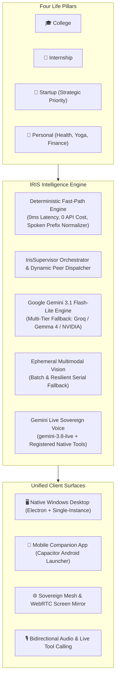
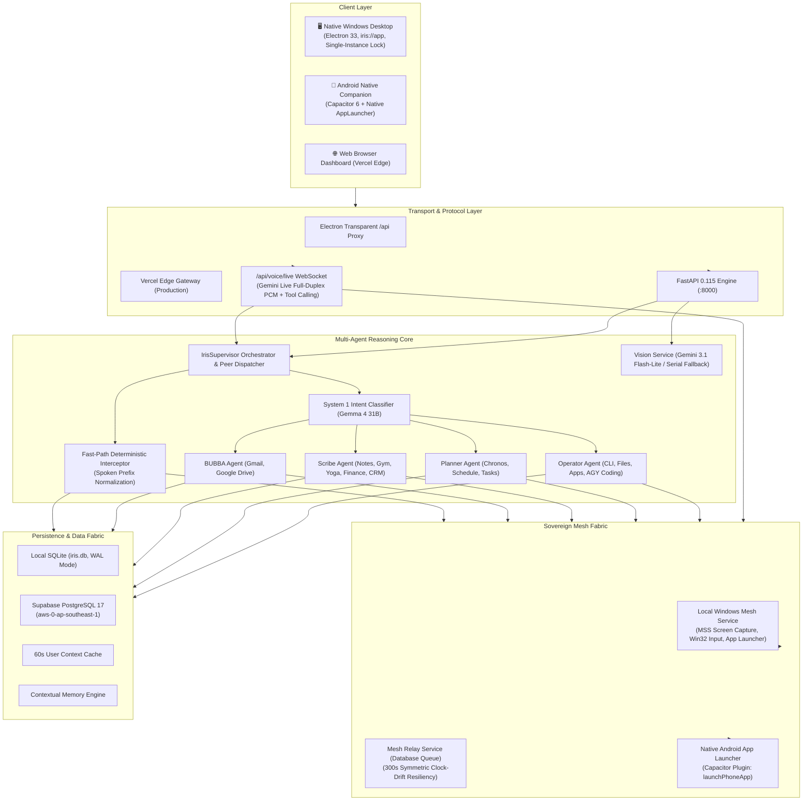
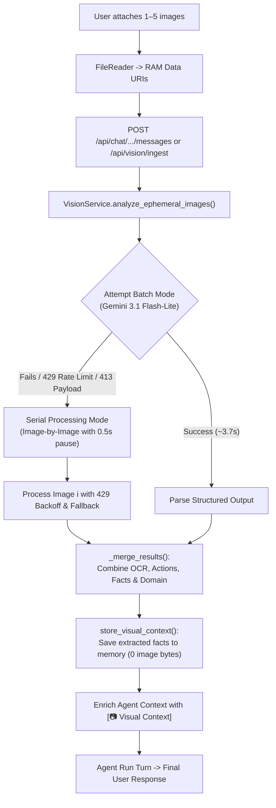
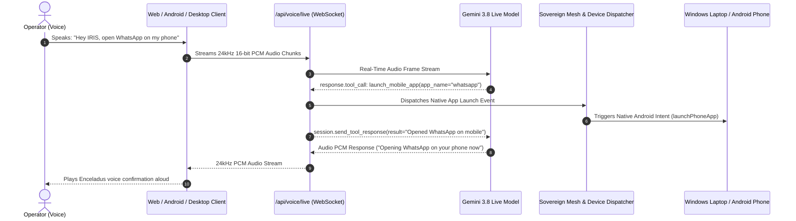
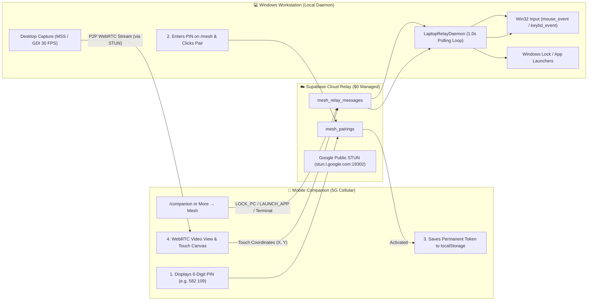

# IRIS — Complete System Architecture & Knowledge Transfer Specification

> **System Designation**: IRIS (*Intelligent Responsive Information System*)  
> **Repository**: `C:\kirtan\IRIS`  
> **Version**: 3.4 (P1 Complete Intelligence Architecture Rework: 10-Stage Unified Reasoning Loop, Authoritative Postcondition Verification, Risk-Level Policy Gates, Context-Preserving Sub-Agent Swarm, Unstarved Cross-Domain Core Orchestration)  
> **Target Audience**: Core Engineers, Systems Architects, and Technical Maintainers  

---

## Table of Contents
1. [Executive Summary & What IRIS Is](#1-executive-summary--what-iris-is)
2. [Core Principles & Design Philosophy](#2-core-principles--design-philosophy)
3. [End-to-End System Architecture](#3-end-to-end-system-architecture)
4. [The Multi-Agent Swarm & Supervisor](#4-the-multi-agent-swarm--supervisor)
5. [Ephemeral Multimodal Vision Pipeline](#5-ephemeral-multimodal-vision-pipeline)
6. [Voice Engine & Situational Awareness](#6-voice-engine--situational-awareness)
7. [Sovereign Mesh Network & Remote Desktop Mirroring](#7-sovereign-mesh-network--remote-desktop-mirroring)
8. [Comprehensive Tech Stack Breakdown](#8-comprehensive-tech-stack-breakdown)
9. [Hosting, Environments & Deployment Topologies](#9-hosting-environments--deployment-topologies)
10. [Codebase Anatomy & Directory Tree](#10-codebase-anatomy--directory-tree)
11. [Operational Runbook & Developer Cheatsheet](#11-operational-runbook--developer-cheatsheet)

---

## 1. Executive Summary & What IRIS Is

### What is IRIS?
**IRIS** is not a generic to-do list, and it is not a simplistic chatbot wrapper. It is a **Sovereign Personal Operating System (Personal OS) and Executive Command Center** engineered for a single high-output operator managing four concurrent life pillars:
- 🎓 **COLLEGE**: Academic deadlines, course assignments, lab deliverables, exam prep.
- 💼 **INTERNSHIP**: Paid software engineering deliverables, code reviews, standups.
- 🚀 **STARTUP (Strategic Priority)**: Customer prospecting, outreach pipeline, investor/customer demos, product shipping.
- 🧘 **PERSONAL**: Health, weightlifting routines, daily all-week yoga asanas, habit streaks, personal finance & cash flow.

In standard workflows, productivity is fragmented: tasks in Todoist, calendar in Google Calendar, workouts in fitness apps, finance in Notion/Splitwise, code in IDEs, and notes in Obsidian. 

**IRIS unifies all four life domains** into a single, cohesive, self-hosted intelligence fabric answering four existential operational questions in real time:
1. **What matters today?** (High-leverage focus vs trivial busyness)
2. **What should I do right now?** (Deterministic constraint-aware recommendation)
3. **Is anything urgent or falling behind?** (Deadlines, pipeline follow-ups, habit consistency)
4. **Am I making meaningful progress?** (Real outcomes: customers, replies, code shipped, workouts finished — *Progress > Activity*)



---

## 2. Core Principles & Design Philosophy

1. **Progress > Activity**:
   Success is measured by concrete results (prospects contacted, replies, meetings booked, code merged, workouts completed), not hours seated at a desk.
2. **Deterministic Truth, AI Reasoning**:
   Deterministic engines handle truth (time constraints, availability, hard deadlines, status queries, completions). Machine learning provides reasoning, synthesis, and creative assistance. IRIS never hallucinates facts when deterministic truth is available.
3. **Zero-Latency Fast-Paths (Jev Principle)**:
   Any request with a known deterministic answer (e.g. *"what should I do now?"*, *"gym done"*, *"lock workstation"*, *"open terminal"*, *"open whatsapp"*) bypasses the LLM completely. It responds in `< 15ms` with zero token consumption and zero rate-limit exposure.
4. **Multi-Layer Context Caching**:
   Against remote PostgreSQL databases (e.g. Supabase), decision context, personal profiles, and situations are cached for 60 seconds per user, eliminating 6.6s of sequential SQL queries on every turn. Write tools automatically invalidate the cache.
5. **Zero-Image-Storage Guarantee**:
   Uploaded images exist strictly in RAM for ephemeral visual extraction. Image bytes are never written to disk, databases, or logs. Only extracted context, OCR, and actionable items survive as durable memory.
6. **Sovereign Cross-Device Peer Interoperability**:
   Laptop and mobile phone operate as peer execution nodes across the IRIS Mesh. Commands spoken or typed on phone can spawn apps and shell sessions on laptop, and laptop commands can trigger native Android apps on phone in milliseconds.
7. **Cognitive Obsidian UI/UX**:
   Surfaces are rendered in deep obsidian (`#080A0F`, `#0D1117`, `#151B23`) with high-contrast typography (Chakra Petch display, Barlow body, JetBrains Mono telemetry). Luminous status beacons indicate AI activity without visual clutter.
8. **Sovereign Ownership & $0 Ongoing Cloud Cost**:
   The entire system runs on your local workstation and personal devices, relying on free-tier Supabase PostgreSQL and Google Gemini endpoints. No recurring SaaS subscriptions.

---

## 3. End-to-End System Architecture



---

## 4. The Multi-Agent Swarm & Supervisor

At the center of IRIS's intelligence is `IrisSupervisor` ([`supervisor.py`](file:///C:/kirtan/IRIS/backend/app/agent/supervisor.py)), orchestrating domain specialists under an inverted single-front-door paradigm. The user speaks solely with IRIS; IRIS routes and delegates.

### 1. Deterministic Fast-Path Interceptor
Before any prompt touches an LLM API, `try_fast_path()` analyzes user intent with conversational speech normalization:
- **Natural Spoken Normalization (`norm_msg`)**: Strips conversational speech prefixes (`"hey iris"`, `"can you please"`, `"could you please"`, `"would you"`, `"please"`, etc.) before pattern matching.
- **Universal Dynamic Peer Action Dispatcher (Zero Hardcoding, Millisecond Execution)**:
  - Dynamically routes app launch commands to the target device (Windows Laptop vs Android Phone).
  - Target Resolution: Spoken indicators (`"on my laptop"`, `"on my phone"`) or device heuristics (mobile apps: WhatsApp, Camera, Instagram, GPay, Uber, Swiggy; desktop apps: Terminal, AGY CLI, VS Code, Explorer).
  - Millisecond execution without LLM roundtrips.
- **Time & Date**: Instant local timestamp formatting (~1.1s turn total).
- **Today's Tasks Checklist** (*"what are my today's tasks"*, *"today's tasks"*, *"show today's tasks"*): Returns an immediate formatted Markdown checklist with priority emojis (🔴 CRITICAL, 🟡 HIGH, ⚪ MEDIUM, 🟢 LOW), deadlines, and completed items in `< 15ms`.
- **Direct Task Creation** (*"create task [title]"*, *"add daily task [title]"*): Instantly creates tasks in the database with contextual area defaults and automatic end-of-day deadline.
- **Top Priority Task** (*"what's my task"*, *"what should I do"*): Calls `deterministic_decision(db, user)` to score all open tasks against deadlines, project weighting, and available schedule blocks.
- **Task Completion** (*"task done"*, *"completed task"*): Marks top open task complete and returns the next highest-leverage task.
- **Fitness & Yoga Checkoffs** (*"gym done"*, *"yoga done"*, *"asana done"*): Instantly marks daily workout / yoga routines and habits complete.
- **Workstation Commands** (*"lock pc"*, *"lock laptop"*, *"ring phone"*, *"open terminal"*, *"launch agy"*): Executes native commands instantly across the mesh.
- **Contextual Memory Search** (*"what do you remember about me"*): Retrieves stored key-value memories directly from the database.

### 2. Two-Tier Intent Routing
If the request requires complex execution:
1. **Tier 1 (Deterministic Keyword Match, 0ms)**: Instant rule-based classification.
2. **Tier 2 (System 1 Decision Engine, ~400ms)**: Uses Google Gemma 4 31B (`gemma-4-31b-it`) in a single forward pass with `temperature=0.0` and zero tool schema clutter to categorize into:
   - `[A]` **Operator**
   - `[B]` **Planner**
   - `[C]` **Scribe**
   - `[D]` **BUBBA**
   - `[E]` **Chat / Orchestrator**

### 3. Specialized Sub-Agents

| Sub-Agent | Primary Responsibilities | Available Tools |
|---|---|---|
| **Operator** | Workstation OS actions, controlled PowerShell/CLI execution, background tasks, directory navigation, file reading/writing/searching, process & port inspection, Antigravity (AGY) ConPTY autonomous coding dispatch, Windows app launching, and mobile app launching. | `execute_desktop_command`, `get_background_job_status`, `cancel_background_job`, `inspect_desktop_process`, `find_latest_laptop_file`, `run_laptop_terminal_command`, `read_laptop_file`, `write_laptop_file`, `search_laptop_files`, `launch_laptop_app`, `launch_mobile_app`, `start_autonomous_coding` |
| **Planner** | Chronos dynamic availability engine, schedule time-blocking, task hierarchies, subtask breakdown, project milestone tracking, daily review generation. | `create_task`, `update_task`, `complete_task`, `get_today_tasks`, `get_tasks`, `create_timeblock`, `get_daily_schedule`, `plan_day_draft` |
| **Scribe** | Personal knowledge & daily task management, journal entries, Gym lifting splits, daily all-week Yoga routines & asana tracking, habit streaks, personal finance (expenses, cash flow, budgets), startup CRM outreach pipeline. | `get_today_tasks`, `get_tasks`, `get_task`, `create_task`, `update_task`, `complete_task`, `delete_task`, `log_diary_entry`, `read_diary`, `log_workout`, `check_yoga_asana`, `log_expense`, `get_finances`, `update_lead_status` |
| **BUBBA** | Google Workspace ecosystem integration: Gmail inbox reading, thread triage, drafting replies, sending emails; Google Drive search and document analysis. | `list_unread_emails`, `search_emails`, `draft_email`, `send_email`, `search_drive_files`, `read_drive_document` |

### 4. Gemini 3.x Thought Signature Preservation
Gemini 3.x models emit provider-specific `extra_content.google.thought_signature` tokens on tool calls. The harness preserves these signatures on `ToolCallRequest` and echoes them back during multi-turn execution, while safely stripping them during failover to non-Gemini models (Gemma, Groq) to avoid HTTP 400 parameter errors.

### 5. Unified 10-Stage Agentic Reasoning Loop (`UnifiedReasoningEngine`)
In Version 3.4, IRIS has fundamentally evolved from a keyword/regex command router into a genuinely generative, reasoning-driven, context-aware autonomous personal intelligence system.


1. **Understand**: Interprets complex objectives, handles natural phrasing variations, resolves entity referents across conversation history ("the second one", "that task"), and detects queries answerable directly from context without calling unnecessary tools.
2. **Contextualize**: Synthesizes active personal model, situational context, and bounded long-term memories from `memory_service`.
3. **Reason**: Evaluates dependencies, risks, and feasibility before choosing an approach.
4. **Plan**: Formulates step-by-step execution workflows with verification checkpoints.
5. **Select Capabilities**: Matches required steps against the tool registry and validates execution policies.
6. **Execute**: Dispatches calls through `AgentHarness` (`native_tools` or `structured_json`).
7. **Observe**: Captures return data, exit codes, and side effects.
8. **Verify**: Authoritatively queries real state (database records, filesystem, running processes).
9. **Adapt**: Diagnoses errors (parameter error, transient, missing entity, unverified postcondition) and adapts parameters or reports discrepancies honestly.
10. **Respond**: Constructs evidence-grounded final reply. Never claims an action succeeded if postcondition verification failed.

### 6. Authoritative Postcondition Verification & Policy Gate
- **Tool Metadata Contract (`Tool`)**:
  - `risk_level`: `READ_ONLY`, `REVERSIBLE`, `ORDINARY_WRITE`, `SENSITIVE`
  - `verification_strategy`: `NONE`, `DB_CHECK`, `FILE_CHECK`, `PROCESS_CHECK`, `CUSTOM`
  - `requires_approval`: bool
  - `verify(db, user, result, **params)`: Authoritative postcondition check method.
- **Verification Enforcement**:
  - `CreateTaskTool` / `UpdateTaskTool`: Validates entity exists in database with matching attributes.
  - `CompleteTaskTool`: Validates entity is in `COMPLETED` status.
  - `DeleteTaskTool`: Validates entity is deleted and no longer present.
  - `CreateTimeBlockTool`: Validates block exists in schedule.
  - Unverified mutating actions (`verified: false`) are excluded from `actions_summary` and reported honestly.
- **Deterministic Approval Gate**:
  - Sensitive / destructive actions require cryptographic approval tokens (`appr_...`).
  - Without an approval token, tool execution halts with `APPROVAL_REQUIRED` and supplies a single-use token.
  - Execution proceeds only once the user replies with authorization (`approve <token>`).

### 7. Cross-Domain Orchestration & Subagent Context Continuity
- **Unstarved Core Agent**: `IrisAgent` possesses full capabilities across all domains (College, Internship, Startup, Personal, Desktop CLI, Mesh, Diary, Workouts, Email, Coding, and Finance). Cross-domain workflows are handled seamlessly by IRIS Core.
- **Context-Preserving Subagents**: When specialized single-domain subagents are dispatched (`Operator`, `Planner`, `Scribe`, `BUBBA`), the full conversation history is passed, eliminating the previous stateless `history=[]` context loss.

---

## 5. Ephemeral Multimodal Vision Pipeline

The vision pipeline ([`vision_service.py`](file:///C:/kirtan/IRIS/backend/app/services/vision_service.py)) provides ephemeral visual comprehension for receipts, invoices, error screens, syllabi, and documents.



### Key Engineering Features:
1. **Multi-Image Support**: Accepts single `image_base64` or a list of `images: [ImageAttachment]` up to 10 MB per image.
2. **Resilient Serial Fallback**:
   - Tries fast batch analysis first (~3.7s).
   - If batch mode encounters an **HTTP 429 (rate limit)**, **HTTP 413 (payload too large)**, or timeout, it automatically pivots to serial mode without crashing.
   - In serial mode, each image is analyzed individually with an exponential backoff buffer, and all OCR text, actions, and facts are merged.
3. **Provider Failover**: Primary vision runs on `gemini-3.1-flash-lite`, automatically failing over to `nvidia/nemotron-3.5-super-vl-120b-a12b` if the Google endpoint is unavailable.
4. **Client Object URL Lifetime**: Object URLs in React are tracked via `useRef<Set<string>>` and revoked strictly on component unmount or explicit removal, eliminating premature thumbnail revocation.

---

## 6. Voice Engine & Situational Awareness

IRIS features dual voice operating modes: **Real-Time Gemini Live Bidirectional WebSocket** and **Turn-Based Conversational Voice**, fully integrated with sovereign workstation and mobile peer controls.



### 1. Gemini Live Bidirectional WebSocket (`/api/voice/live`)
- **Model**: `gemini-3.8-live` with `response_modalities=["AUDIO"]` and `Enceladus` voice personality.
- **Sovereign Tool Calling**: Configured directly in `types.LiveConnectConfig(tools=tools_list)`:
  - `launch_laptop_app(app_name, directory)`: Launches Windows apps (Terminal, VS Code, Chrome, etc.).
  - `launch_mobile_app(app_name)`: Broadcasts launch event over WebSocket and pushes mesh relay message to open apps natively on Android.
  - `execute_terminal_command(command)`: Runs shell/PowerShell commands on the laptop and speaks results.
  - `get_laptop_status()`: Speaks real-time laptop battery percentage, charging state, and mesh connectivity.
  - `lock_laptop()`: Engages the Sovereign Privacy Shield on the Windows display.
  - `create_daily_task(title, area, priority)`: Creates a new task in the database and returns task ID and title.
  - `get_today_tasks()`: Retrieves all tasks scheduled or due today, categorized into open, in-progress, and completed.
  - `complete_task(task_id)`: Marks an open task completed in the database.
- **Real-Time Tool Interception**: `gemini_to_client()` catches `response.tool_call.function_calls`, runs the native action, and sends back `session.send_tool_response(function_responses=...)` so the model audibly confirms execution with zero latency.

### 2. Turn-Based Conversational Voice (`converse()`)
- **Speech-to-Text (STT)**: Server-side Groq Whisper / Gemini Transcribe (`gemini-3.5-transcribe`) with fallback to Android/browser Web Speech API (`hi-IN` / `en-IN`).
- **Text-to-Speech (TTS)**: Server-side Gemini Speech Engine (`gemini-3.8-flash-tts`) with fallback to native OS speech synthesis.
- **Natural Spoken Normalization (`norm_msg`)**: Strips conversational spoken prefixes (`"hey iris"`, `"can you please"`, `"could you please"`, etc.) before intent matching in `IrisSupervisor`, guaranteeing instant deterministic fast-path execution.
- **Situational Telemetry Injection**: Real-time workstation status, top priority tasks, remaining free time blocks, and current habits are automatically injected into conversational prompts.

---

## 7. Sovereign Mesh Network & Remote Desktop Mirroring

The **Sovereign Mesh** connects your mobile phone (on any 5G network or hotel Wi-Fi) with your Windows laptop workstation at **$0 cloud cost**, without open router ports, dynamic DNS, or third-party paid tunnels (like ngrok).



### The 3-Step Zero-QR Handshake
1. **Phone Opens Pairing**: On phone, navigate to `https://iris.example.com/companion` (or **More &rarr; Mesh**). The phone creates an active invite and renders a bold 6-digit PIN.
2. **Laptop Verifies**: On your laptop, open `/mesh`, type the 6-digit PIN, and click **"Pair Phone Forever"**.
3. **Mutual Handshake**: Supabase marks the pairing record active. The phone immediately receives the verification and saves `iris_pair_token` to `localStorage`. Both devices are linked indefinitely.

### Remote Workstation Capabilities Over Mesh
- **Workstation Security**: Instant remote lock (`LockWorkstation` / Sovereign Privacy Shield).
- **Find My Phone**: Ring phone at 100% volume through web audio even if set on silent.
- **Universal Clipboard**: Instant two-way copy/paste synchronization.
- **Autonomous Coding Task Dispatch**: Start background coding tasks via Antigravity CLI from your phone while away from your desk.
- **WebRTC Remote Desktop Mirroring**: Stream your Windows desktop at 30 FPS to your phone with touch-to-click and mobile keyboard input.
- **Bidirectional Native App Launching**:
  - *Phone to Laptop*: Launch Terminal, Antigravity IDE, VS Code, or custom shell commands on your Windows PC.
  - *Laptop to Phone*: Trigger native Android intents to launch WhatsApp, Camera, Settings, GPay, Uber, etc.
- **Hardware Telemetry & Battery Monitoring**: Real-time battery level percentage and charging state tracked and spoken by the agent.

### 4. Clock-Drift Resilient Telemetry Engine
In asymmetric networks (Vercel serverless cloud + Windows laptop + Android 5G), minor NTP system clock skews can cause false-positive offline states.
- **Symmetric Clock-Drift Window**: Uses `abs(now - last_seen) < 300.0s`, allowing symmetric clock drift up to 5 minutes between serverless functions and client devices.
- **Active Heartbeat & Relay Sync**: The laptop daemon updates `last_seen` every 3 seconds while actively processing commands, guaranteeing continuous availability reporting.

---

## 8. Comprehensive Tech Stack Breakdown

### Frontend (User Interface)
- **Framework**: React 18.3 Single Page Application (SPA) with TypeScript 5.6.
- **Mobile Container**: Capacitor 6 (`@capacitor/core`, `@capacitor/android`) with custom native plugins for app launching (`AppLauncher`) and system settings.
- **Bundler & Tooling**: Vite 6.4 with `@vitejs/plugin-react` and `vite-plugin-pwa`.
- **Styling**: Tailwind CSS 3.4 with custom "Cognitive Obsidian" palette variables.
- **State & Server Cache**: TanStack React Query v5 (`@tanstack/react-query`) with automatic query key invalidation and optimistic mutations.
- **Routing**: Lightweight history-based custom router with hash navigation support and URL synchronization.
- **Iconography**: Lucide React (`lucide-react`).

### Backend (API & Intelligence Server)
- **Framework**: FastAPI 0.115 on Python 3.13.
- **ASGI Server**: Uvicorn with async event loops.
- **ORM & Data Layer**: SQLAlchemy 2.0 with both synchronous (`Session`) and connection-pooled execution modes.
- **Database Driver**: `psycopg 3` (PostgreSQL) and native `sqlite3` (SQLite).
- **Schema Migrations**: Alembic 1.14.
- **Data Validation**: Pydantic v2.

### AI & Reasoning Engine
- **Active Chat & Multi-Agent Core**: Google Gemini 3.1 Flash-Lite (`gemini-3.1-flash-lite`) with multi-tier failover across Groq (`qwen/qwen3.8-27b`), `gemma-4-26b-a4b-it`, and `gemini-3.5-flash`.
- **Router Model**: Google Gemma 4 31B (`gemini:gemma-4-31b-it`) for zero-overhead single-token JEV classification.
- **Ephemeral Vision**: `gemini-3.1-flash-lite` (batch + serial fallback) with fallback to `nvidia/nemotron-3.5-super-vl-120b-a12b`.
- **Live Bidirectional Audio Engine**: Google GenAI SDK (`google.genai` Live API, `gemini-3.8-live`) with registered sovereign tools (`launch_laptop_app`, `launch_mobile_app`, `execute_terminal_command`, `get_laptop_status`, `lock_laptop`) and real-time `tool_call` response handling.
- **Voice STT**: `gemini-3.5-transcribe` / Groq Whisper / HTML5 Web Speech.
- **Voice TTS**: `gemini-3.8-flash-tts` with `Enceladus` voice.
- **Autonomous Coding**: Antigravity (AGY) ConPTY PTY bridge.

### Native Desktop Packaging
- **Runtime**: Electron 33.
- **Distribution**: Standalone Windows package in `desktop/dist/IRIS-win32-x64/IRIS.exe`.
- **Dual-Mode Serving**: Automatically loads production URL for zero-friction OTA updates while seamlessly falling back to local `dist-frontend`.
- **Single-Instance Lock**: Prevents duplicate processes; automatically restores and focuses existing window when relaunched.
- **API Proxy**: In-process proxying of `/api/*` requests to the local FastAPI backend daemon on `127.0.0.1:8000`.
- **System Tray**: Windows system tray integration with background minimization, global hotkeys (`Alt+I`), and an auto-resurrecting backend watchdog.

---

## 9. Hosting, Environments & Deployment Topologies

### Topology A: Native Windows Desktop Workstation (Current Daily Driver)
- **Backend**: Runs locally as a silent Windows background process via `start-mesh-silent.vbs` on port 8000.
- **Frontend**: Served directly through Electron (`iris://app/index.html`) reading precompiled static assets from `desktop/dist-frontend`.
- **Database**: Local `backend/iris.db` (SQLite with WAL mode) or remote Supabase PostgreSQL.
- **Launcher**: Double-click [`start-iris-app.bat`](file:///C:/kirtan/IRIS/start-iris-app.bat) or press `Alt+I`.

### Topology B: Cloud Serverless (Vercel + Supabase)
- **Frontend**: Hosted globally on Vercel's Edge Network (`/` &rarr; `frontend/dist`).
- **Backend**: Serverless FastAPI execution via `api/index.py` (`/api/*`).
- **Database**: Supabase Managed PostgreSQL 17 connected via Transaction Pooler (`:6543`) with SQLAlchemy `NullPool`.
- **Configuration**: Documented in [`VERCEL.md`](file:///C:/kirtan/IRIS/VERCEL.md).

### Topology C: Self-Hosted VPS (Coolify / Docker Compose)
- **Containers**: Two Docker containers (Frontend Nginx + Backend FastAPI) connected over an internal bridge network.
- **Reverse Proxy**: Coolify / Traefik providing automatic Let's Encrypt SSL on a single domain.
- **Database**: Persistent SQLite volume mounted at `/app/data/iris.db` with automated Alembic migrations on container startup.
- **Configuration**: Documented in [`COOLIFY.md`](file:///C:/kirtan/IRIS/COOLIFY.md) and [`docker-compose.yml`](file:///C:/kirtan/IRIS/docker-compose.yml).

### Topology D: Managed Cloud Container (Render + Supabase)
- **Backend**: Render Web Service running Uvicorn workers with `alembic upgrade head` pre-deploy hook.
- **Database**: Supabase PostgreSQL connected via Session Pooler (`:5432`).
- **Configuration**: Documented in [`SUPABASE.md`](file:///C:/kirtan/IRIS/SUPABASE.md).

---

## 10. Codebase Anatomy & Directory Tree

```text
C:\kirtan\IRIS\
├── api/                        # Vercel serverless entrypoint
│   └── index.py                # Serverless FastAPI adapter
├── backend/                    # Core Python intelligence backend
│   ├── app/
│   │   ├── agent/              # Multi-agent system
│   │   │   ├── agents/         # Sub-agents (operator, planner, scribe, bubba)
│   │   │   ├── tools/          # Discrete agent tools (tasks, mesh, finance, workouts)
│   │   │   ├── supervisor.py   # IrisSupervisor orchestrator & fast-paths
│   │   │   └── harness.py      # LLM invocation harness & retries
│   │   ├── ai/                 # Multi-provider AI abstractions (Gemini, NVIDIA, Groq)
│   │   │   ├── capabilities.py # Model feature profiles & token limits
│   │   │   ├── factory.py      # Dynamic provider instantiator & failover chains
│   │   │   └── providers/      # Provider implementations
│   │   ├── api/routes/         # FastAPI REST endpoints (chat, vision, mesh, voice)
│   │   ├── core/               # Configuration, security, database session setup
│   │   ├── intelligence/       # Deterministic priority engine & time allocator
│   │   ├── models/             # SQLAlchemy ORM models (Task, Goal, Workout, Mesh)
│   │   ├── services/           # Business logic (vision, mesh_relay, screen, memory)
│   │   └── main.py             # FastAPI app instantiation & lifespan
│   ├── alembic/                # Database schema migrations
│   ├── run_daemon.py           # Workstation daemon runner
│   └── requirements.txt        # Python dependency manifest
├── frontend/                   # React 18 / Vite SPA
│   ├── src/
│   │   ├── components/         # Reusable UI primitives (dialogs, buttons, cards)
│   │   ├── features/           # Domain feature views
│   │   │   ├── ai/             # Ask IRIS overlay console
│   │   │   ├── gym/            # Gym splits & dedicated all-week Yoga flow
│   │   │   ├── home/           # Today dashboard, priority recommendations, and voice live
│   │   │   ├── mesh/           # Sovereign mesh manager & screen mirroring
│   │   │   ├── schedule/       # Chronos calendar & time blocks
│   │   │   └── startup/        # Outreach CRM & experiment pipeline
│   │   ├── hooks/              # TanStack Query hooks (useWorkouts, useTasks)
│   │   ├── lib/                # Shared utilities & Capacitor native bridges (appLauncher.ts)
│   │   └── modules/            # Navigation registry & module metadata
│   └── package.json            # Frontend dependency manifest
├── desktop/                    # Native Electron application
│   ├── dist/                   # Standalone packaged distribution
│   │   └── IRIS-win32-x64/     # Prebuilt Windows portable binary
│   │       └── IRIS.exe        # Standalone executable
│   ├── dist-frontend/          # Synchronized production frontend bundle
│   ├── main.cjs                # Electron main process (iris:// protocol & tray)
│   └── package.json            # Desktop Electron dependencies
├── scripts/                    # Maintenance & automation scripts
│   ├── install-desktop.ps1     # Automated Electron packager & frontend asset copier
│   └── migrate_to_supabase.py  # SQLite to Supabase database migration script
├── reinstall-desktop.bat       # One-click clean reinstall of desktop app
├── start-iris-app.bat          # Workstation desktop app launcher
├── start-mesh-silent.vbs       # Silent background backend daemon launcher
├── COOLIFY.md                  # VPS production deployment instructions
├── SUPABASE.md                 # PostgreSQL migration & Supabase guide
└── VERCEL.md                   # Serverless deployment guide
```

---

## 11. Operational Runbook & Developer Cheatsheet

### 1. Launching IRIS on the Windows Workstation
```powershell
# Quick Launch (Starts background daemon & launches native Electron UI):
C:\kirtan\IRIS\start-iris-app.bat
```

### 2. Running Local Development Servers Manually
```powershell
# Terminal 1: Start Backend (FastAPI on Port 8000)
cd C:\kirtan\IRIS\backend
.\.venv\Scripts\Activate.ps1
python run_daemon.py

# Terminal 2: Start Frontend (Vite on Port 5173)
cd C:\kirtan\IRIS\frontend
npm run dev
```

### 3. Running Test Suites
```powershell
# Backend Pytest Suite (384 passed)
cd C:\kirtan\IRIS\backend
.\.venv\Scripts\python.exe -m pytest -q

# Frontend Typecheck & Build
cd C:\kirtan\IRIS\frontend
npm run build
```

### 4. Applying Database Migrations
```powershell
cd C:\kirtan\IRIS\backend
alembic upgrade head
```

### 5. Synchronizing Frontend Build into Desktop App
Whenever frontend code in `frontend/src` is modified, rebuild and sync into Electron:
```powershell
cd C:\kirtan\IRIS\frontend
npm run build
Copy-Item -Recurse -Force "dist\*" "..\desktop\dist\IRIS-win32-x64\resources\app\dist-frontend\"
```

### 6. Clean Desktop App Reinstallation
To wipe stale Electron processes and reinstall the native desktop executable from scratch:
```bat
C:\kirtan\IRIS\reinstall-desktop.bat
```

### 7. Over-the-Air (OTA) Zero-APK Mobile Updates
Because the Android app is powered by a modern Capacitor WebView pointing to your production web deployment, code updates require zero Android Studio re-compilations:
```powershell
# 1. Commit and push to main
git push origin main
# 2. Vercel automatically deploys the updated frontend and serverless API
# 3. Open the IRIS app on your Android phone — the new features appear instantly!
```

---
*IRIS Architecture Specification & Knowledge Transfer Guide — Maintained by Core Engineering.*
