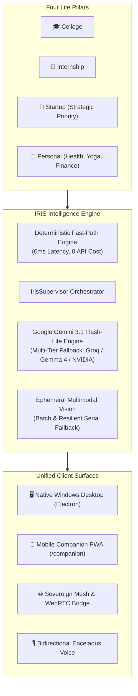
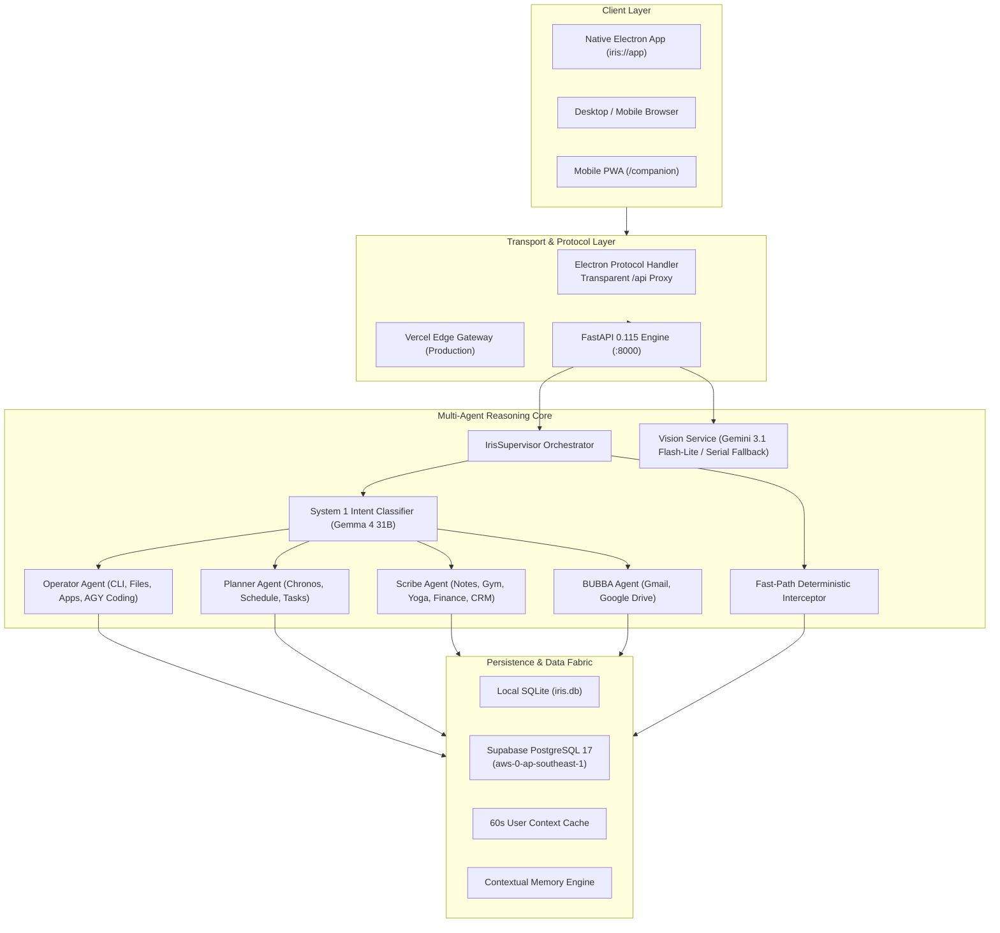
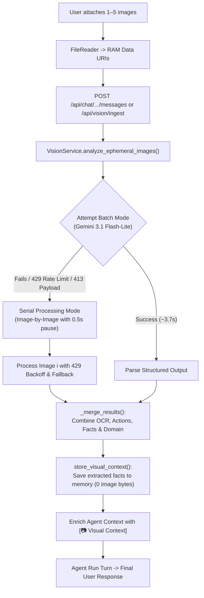
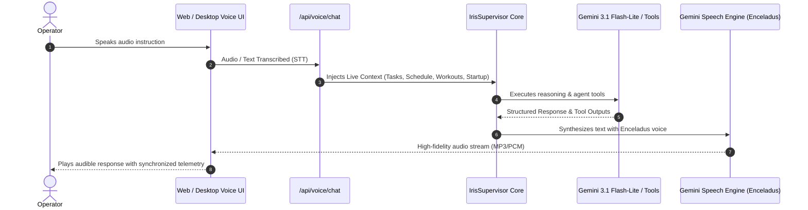
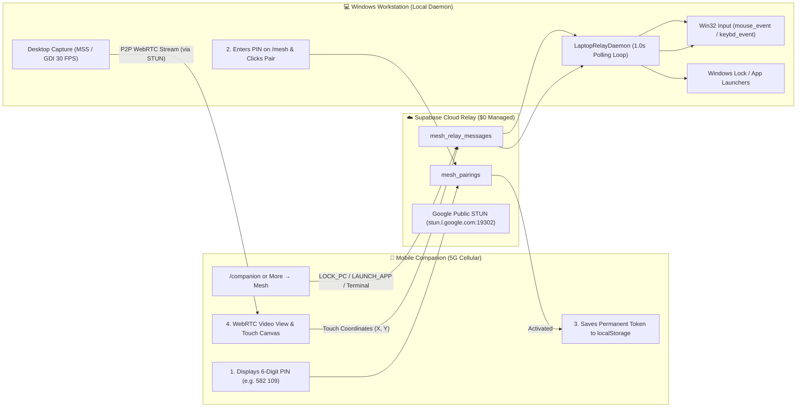

# IRIS — Complete System Architecture & Knowledge Transfer Specification

> **System Designation**: IRIS (*Intelligent Responsive Information System*)  
> **Repository**: `C:\kirtan\IRIS`  
> **Version**: 2.6 (Sovereign Multi-Agent, WebRTC Mesh, Gemini 3.1 Flash-Lite, Resilient Ephemeral Vision, Enceladus Voice, Antigravity ConPTY Bridge)  
> **Target Audience**: Core Engineers, Systems Architects, and Technical Maintainers  

---

## Table of Contents
1. [Executive Summary & What IRIS Is](#1-executive-summary--what-iris-is)
2. [Core Principles & Design Philosophy](#2-core-principles--design-philosophy)
3. [End-to-End System Architecture](#3-end-to-end-system-architecture)
4. [The Multi-Agent Swarm & Supervisor](#4-the-multi-agent-swarm--supervisor)
5. [Ephemeral Multimodal Vision Pipeline](#5-ephemeral-multimodal-vision-pipeline)
6. [Voice Engine & Situational Awareness](#6-voice-engine--situational-awareness)
7. [Sovereign Mesh Network & Remote Desktop Mirroring](#7-sovereign-mesh-network--remote-desktop-mirroring)
8. [Comprehensive Tech Stack Breakdown](#8-comprehensive-tech-stack-breakdown)
9. [Hosting, Environments & Deployment Topologies](#9-hosting-environments--deployment-topologies)
10. [Codebase Anatomy & Directory Tree](#10-codebase-anatomy--directory-tree)
11. [Operational Runbook & Developer Cheatsheet](#11-operational-runbook--developer-cheatsheet)

---

## 1. Executive Summary & What IRIS Is

### What is IRIS?
**IRIS** is not a generic to-do list, and it is not a simplistic chatbot wrapper. It is a **Sovereign Personal Operating System (Personal OS) and Executive Command Center** engineered for a single high-output operator managing four concurrent life pillars:
- 🎓 **COLLEGE**: Academic deadlines, course assignments, lab deliverables, exam prep.
- 💼 **INTERNSHIP**: Paid software engineering deliverables, code reviews, standups.
- 🚀 **STARTUP (Strategic Priority)**: Customer prospecting, outreach pipeline, investor/customer demos, product shipping.
- 🧘 **PERSONAL**: Health, weightlifting routines, daily all-week yoga asanas, habit streaks, personal finance & cash flow.

In standard workflows, productivity is fragmented: tasks in Todoist, calendar in Google Calendar, workouts in fitness apps, finance in Notion/Splitwise, code in IDEs, and notes in Obsidian. 

**IRIS unifies all four life domains** into a single, cohesive, self-hosted intelligence fabric answering four existential operational questions in real time:
1. **What matters today?** (High-leverage focus vs trivial busyness)
2. **What should I do right now?** (Deterministic constraint-aware recommendation)
3. **Is anything urgent or falling behind?** (Deadlines, pipeline follow-ups, habit consistency)
4. **Am I making meaningful progress?** (Real outcomes: customers, replies, code shipped, workouts finished — *Progress > Activity*)



---

## 2. Core Principles & Design Philosophy

1. **Progress > Activity**:
   Success is measured by concrete results (prospects contacted, replies, meetings booked, code merged, workouts completed), not hours seated at a desk.
2. **Deterministic Truth, AI Reasoning**:
   Deterministic engines handle truth (time constraints, availability, hard deadlines, status queries, completions). Machine learning provides reasoning, synthesis, and creative assistance. IRIS never hallucinates facts when deterministic truth is available.
3. **Zero-Latency Fast-Paths (Jev Principle)**:
   Any request with a known deterministic answer (e.g. *"what should I do now?"*, *"gym done"*, *"lock workstation"*, *"what's the time"*) bypasses the LLM completely. It responds in `< 15ms` with zero token consumption and zero rate-limit exposure.
4. **Multi-Layer Context Caching**:
   Against remote PostgreSQL databases (e.g. Supabase), decision context, personal profiles, and situations are cached for 60 seconds per user, eliminating 6.6s of sequential SQL queries on every turn. Write tools automatically invalidate the cache.
5. **Zero-Image-Storage Guarantee**:
   Uploaded images exist strictly in RAM for ephemeral visual extraction. Image bytes are never written to disk, databases, or logs. Only extracted context, OCR, and actionable items survive as durable memory.
6. **Cognitive Obsidian UI/UX**:
   Surfaces are rendered in deep obsidian (`#080A0F`, `#0D1117`, `#151B23`) with high-contrast typography (Chakra Petch display, Barlow body, JetBrains Mono telemetry). Luminous status beacons indicate AI activity without visual clutter.
7. **Sovereign Ownership & $0 Ongoing Cloud Cost**:
   The entire system runs on your local workstation and personal devices, relying on free-tier Supabase PostgreSQL and Google Gemini endpoints. No recurring SaaS subscriptions.

---

## 3. End-to-End System Architecture



---

## 4. The Multi-Agent Swarm & Supervisor

At the center of IRIS's intelligence is `IrisSupervisor` ([`supervisor.py`](file:///C:/kirtan/IRIS/backend/app/agent/supervisor.py)), orchestrating domain specialists under an inverted single-front-door paradigm. The user speaks solely with IRIS; IRIS routes and delegates.

### 1. Deterministic Fast-Path Interceptor
Before any prompt touches an LLM API, `try_fast_path()` analyzes user intent:
- **Time & Date**: Instant local timestamp formatting (~1.1s turn total).
- **Top Priority Task** (*"what's my task"*, *"what should I do"*): Calls `deterministic_decision(db, user)` to score all open tasks against deadlines, project weighting, and available schedule blocks.
- **Task Completion** (*"task done"*, *"completed task"*): Marks top open task complete and returns the next highest-leverage task.
- **Fitness & Yoga Checkoffs** (*"gym done"*, *"yoga done"*, *"asana done"*): Instantly marks daily workout / yoga routines and habits complete.
- **Workstation Commands** (*"lock pc"*, *"ring phone"*, *"open terminal"*, *"launch agy"*): Executes native Windows commands instantly.
- **Contextual Memory Search** (*"what do you remember about me"*): Retrieves stored key-value memories directly from the database.

### 2. Two-Tier Intent Routing
If the request requires complex execution:
1. **Tier 1 (Deterministic Keyword Match, 0ms)**: Instant rule-based classification.
2. **Tier 2 (System 1 Decision Engine, ~400ms)**: Uses Google Gemma 4 31B (`gemma-4-31b-it`) in a single forward pass with `temperature=0.0` and zero tool schema clutter to categorize into:
   - `[A]` **Operator**
   - `[B]` **Planner**
   - `[C]` **Scribe**
   - `[D]` **BUBBA**
   - `[E]` **Chat / Orchestrator**

### 3. Specialized Sub-Agents

| Sub-Agent | Primary Responsibilities | Available Tools |
|---|---|---|
| **Operator** | Workstation OS actions, terminal commands, directory navigation, file reading/writing/searching, Antigravity (AGY) ConPTY autonomous coding dispatch. | `run_terminal_command`, `read_workspace_file`, `write_workspace_file`, `search_files`, `launch_laptop_app`, `trigger_autonomous_coding` |
| **Planner** | Chronos dynamic availability engine, schedule time-blocking, task hierarchies, subtask breakdown, project milestone tracking, daily review generation. | `create_task`, `update_task`, `complete_task`, `create_timeblock`, `get_daily_schedule`, `plan_day_draft` |
| **Scribe** | Personal journal entries, Gym lifting splits, daily all-week Yoga routines & asana tracking, habit streaks, personal finance (expenses, cash flow, budgets), startup CRM outreach pipeline. | `log_diary_entry`, `read_diary`, `log_workout`, `check_yoga_asana`, `log_expense`, `get_finances`, `update_lead_status` |
| **BUBBA** | Google Workspace ecosystem integration: Gmail inbox reading, thread triage, drafting replies, sending emails; Google Drive search and document analysis. | `list_unread_emails`, `search_emails`, `draft_email`, `send_email`, `search_drive_files`, `read_drive_document` |

### 4. Gemini 3.x Thought Signature Preservation
Gemini 3.x models emit provider-specific `extra_content.google.thought_signature` tokens on tool calls. The harness preserves these signatures on `ToolCallRequest` and echoes them back during multi-turn execution, while safely stripping them during failover to non-Gemini models (Gemma, Groq) to avoid HTTP 400 parameter errors.

---

## 5. Ephemeral Multimodal Vision Pipeline

The vision pipeline ([`vision_service.py`](file:///C:/kirtan/IRIS/backend/app/services/vision_service.py)) provides ephemeral visual comprehension for receipts, invoices, error screens, syllabi, and documents.



### Key Engineering Features:
1. **Multi-Image Support**: Accepts single `image_base64` or a list of `images: [ImageAttachment]` up to 10 MB per image.
2. **Resilient Serial Fallback**:
   - Tries fast batch analysis first (~3.7s).
   - If batch mode encounters an **HTTP 429 (rate limit)**, **HTTP 413 (payload too large)**, or timeout, it automatically pivots to serial mode without crashing.
   - In serial mode, each image is analyzed individually with an exponential backoff buffer, and all OCR text, actions, and facts are merged.
3. **Provider Failover**: Primary vision runs on `gemini-3.1-flash-lite`, automatically failing over to `nvidia/nemotron-3.5-super-vl-120b-a12b` if the Google endpoint is unavailable.
4. **Client Object URL Lifetime**: Object URLs in React are tracked via `useRef<Set<string>>` and revoked strictly on component unmount or explicit removal, eliminating premature thumbnail revocation.

---

## 6. Voice Engine & Situational Awareness

IRIS features a full-duplex conversational voice module that operates as a direct portal into the core intelligence engine.



- **STT (Speech-to-Text)**: Gemini Transcribe (`gemini-3.5-transcribe`) with fallback to browser Web Speech API.
- **TTS (Text-to-Speech)**: Google Gemini Voice Engine (`gemini-3.8-live`, `gemini-3.8-flash-tts`) configured with the masculine, calm, authoritative **Enceladus** voice.
- **Situational Injection**: Whenever voice audio is generated, IRIS injects real-time workstation status, top priority tasks, remaining free time blocks, and current habits into the prompt context so that voice answers match visual dashboard data exactly.

---

## 7. Sovereign Mesh Network & Remote Desktop Mirroring

The **Sovereign Mesh** connects your mobile phone (on any 5G network or hotel Wi-Fi) with your Windows laptop workstation at **$0 cloud cost**, without open router ports, dynamic DNS, or third-party paid tunnels (like ngrok).



### The 3-Step Zero-QR Handshake
1. **Phone Opens Pairing**: On phone, navigate to `https://iris.example.com/companion` (or **More &rarr; Mesh**). The phone creates an active invite and renders a bold 6-digit PIN.
2. **Laptop Verifies**: On your laptop, open `/mesh`, type the 6-digit PIN, and click **"Pair Phone Forever"**.
3. **Mutual Handshake**: Supabase marks the pairing record active. The phone immediately receives the verification and saves `iris_pair_token` to `localStorage`. Both devices are linked indefinitely.

### Remote Workstation Capabilities Over Mesh
- **Workstation Security**: Instant remote lock (`LockWorkstation` / Privacy Shield).
- **Find My Phone**: Ring phone at 100% volume through web audio even if set on silent.
- **Universal Clipboard**: Instant two-way copy/paste synchronization.
- **Autonomous Coding Task Dispatch**: Start background coding tasks via Antigravity CLI from your phone while away from your desk.
- **WebRTC Remote Desktop Mirroring**: Stream your Windows desktop at 30 FPS to your phone with touch-to-click and mobile keyboard input.

---

## 8. Comprehensive Tech Stack Breakdown

### Frontend (User Interface)
- **Framework**: React 18.3 Single Page Application (SPA) with TypeScript 5.6.
- **Bundler & Tooling**: Vite 6.4 with `@vitejs/plugin-react` and `vite-plugin-pwa`.
- **Styling**: Tailwind CSS 3.4 with custom "Cognitive Obsidian" palette variables.
- **State & Server Cache**: TanStack React Query v5 (`@tanstack/react-query`) with automatic query key invalidation and optimistic mutations.
- **Routing**: Lightweight history-based custom router with hash navigation support and URL synchronization.
- **Iconography**: Lucide React (`lucide-react`).

### Backend (API & Intelligence Server)
- **Framework**: FastAPI 0.115 on Python 3.13.
- **ASGI Server**: Uvicorn with async event loops.
- **ORM & Data Layer**: SQLAlchemy 2.0 with both synchronous (`Session`) and connection-pooled execution modes.
- **Database Driver**: `psycopg 3` (PostgreSQL) and native `sqlite3` (SQLite).
- **Schema Migrations**: Alembic 1.14.
- **Data Validation**: Pydantic v2.

### AI & Reasoning Engine
- **Active Chat & Multi-Agent Core**: Google Gemini 3.1 Flash-Lite (`gemini-3.1-flash-lite`) with multi-tier failover across Groq (`qwen/qwen3.8-27b`), `gemma-4-26b-a4b-it`, and `gemini-3.5-flash`.
- **Router Model**: Google Gemma 4 31B (`gemini:gemma-4-31b-it`) for zero-overhead single-token JEV classification.
- **Ephemeral Vision**: `gemini-3.1-flash-lite` (batch + serial fallback) with fallback to `nvidia/nemotron-3.5-super-vl-120b-a12b`.
- **Voice STT**: `gemini-3.5-transcribe` / HTML5 Web Speech.
- **Voice TTS**: `gemini-3.8-flash-tts` / `gemini-3.8-live` with `Enceladus` voice.
- **Autonomous Coding**: Antigravity (AGY) ConPTY PTY bridge.

### Native Desktop Packaging
- **Runtime**: Electron 33.
- **Custom Scheme**: `iris://app/` registered as a secure, privileged standard protocol.
- **API Proxy**: In-process proxying of `/api/*` requests to the local FastAPI backend daemon on `127.0.0.1:8000`.
- **System Tray**: Windows system tray integration with background minimization, global hotkeys (`Alt+I`), and an auto-resurrecting backend watchdog.

---

## 9. Hosting, Environments & Deployment Topologies

### Topology A: Native Windows Desktop Workstation (Current Daily Driver)
- **Backend**: Runs locally as a silent Windows background process via `start-mesh-silent.vbs` on port 8000.
- **Frontend**: Served directly through Electron (`iris://app/index.html`) reading precompiled static assets from `desktop/dist-frontend`.
- **Database**: Local `backend/iris.db` (SQLite with WAL mode) or remote Supabase PostgreSQL.
- **Launcher**: Double-click [`start-iris-app.bat`](file:///C:/kirtan/IRIS/start-iris-app.bat) or press `Alt+I`.

### Topology B: Cloud Serverless (Vercel + Supabase)
- **Frontend**: Hosted globally on Vercel's Edge Network (`/` &rarr; `frontend/dist`).
- **Backend**: Serverless FastAPI execution via `api/index.py` (`/api/*`).
- **Database**: Supabase Managed PostgreSQL 17 connected via Transaction Pooler (`:6543`) with SQLAlchemy `NullPool`.
- **Configuration**: Documented in [`VERCEL.md`](file:///C:/kirtan/IRIS/VERCEL.md).

### Topology C: Self-Hosted VPS (Coolify / Docker Compose)
- **Containers**: Two Docker containers (Frontend Nginx + Backend FastAPI) connected over an internal bridge network.
- **Reverse Proxy**: Coolify / Traefik providing automatic Let's Encrypt SSL on a single domain.
- **Database**: Persistent SQLite volume mounted at `/app/data/iris.db` with automated Alembic migrations on container startup.
- **Configuration**: Documented in [`COOLIFY.md`](file:///C:/kirtan/IRIS/COOLIFY.md) and [`docker-compose.yml`](file:///C:/kirtan/IRIS/docker-compose.yml).

### Topology D: Managed Cloud Container (Render + Supabase)
- **Backend**: Render Web Service running Uvicorn workers with `alembic upgrade head` pre-deploy hook.
- **Database**: Supabase PostgreSQL connected via Session Pooler (`:5432`).
- **Configuration**: Documented in [`SUPABASE.md`](file:///C:/kirtan/IRIS/SUPABASE.md).

---

## 10. Codebase Anatomy & Directory Tree

```text
C:\kirtan\IRIS\
├── api/                        # Vercel serverless entrypoint
│   └── index.py                # Serverless FastAPI adapter
├── backend/                    # Core Python intelligence backend
│   ├── app/
│   │   ├── agent/              # Multi-agent system
│   │   │   ├── agents/         # Sub-agents (operator, planner, scribe, bubba)
│   │   │   ├── tools/          # Discrete agent tools (tasks, mesh, finance, workouts)
│   │   │   ├── supervisor.py   # IrisSupervisor orchestrator & fast-paths
│   │   │   └── harness.py      # LLM invocation harness & retries
│   │   ├── ai/                 # Multi-provider AI abstractions (Gemini, NVIDIA, Groq)
│   │   │   ├── capabilities.py # Model feature profiles & token limits
│   │   │   ├── factory.py      # Dynamic provider instantiator & failover chains
│   │   │   └── providers/      # Provider implementations
│   │   ├── api/routes/         # FastAPI REST endpoints (chat, vision, mesh, voice)
│   │   ├── core/               # Configuration, security, database session setup
│   │   ├── intelligence/       # Deterministic priority engine & time allocator
│   │   ├── models/             # SQLAlchemy ORM models (Task, Goal, Workout, Mesh)
│   │   ├── services/           # Business logic (vision, mesh_relay, screen, memory)
│   │   └── main.py             # FastAPI app instantiation & lifespan
│   ├── alembic/                # Database schema migrations
│   ├── run_daemon.py           # Workstation daemon runner
│   └── requirements.txt        # Python dependency manifest
├── frontend/                   # React 18 / Vite SPA
│   ├── src/
│   │   ├── components/         # Reusable UI primitives (dialogs, buttons, cards)
│   │   ├── features/           # Domain feature views
│   │   │   ├── ai/             # Ask IRIS overlay console
│   │   │   ├── gym/            # Gym splits & dedicated all-week Yoga flow
│   │   │   ├── home/           # Today dashboard & priority recommendations
│   │   │   ├── mesh/           # Sovereign mesh manager & screen mirroring
│   │   │   ├── schedule/       # Chronos calendar & time blocks
│   │   │   └── startup/        # Outreach CRM & experiment pipeline
│   │   ├── hooks/              # TanStack Query hooks (useWorkouts, useTasks)
│   │   └── modules/            # Navigation registry & module metadata
│   └── package.json            # Frontend dependency manifest
├── desktop/                    # Native Electron application
│   ├── dist-frontend/          # Synchronized production frontend bundle
│   ├── main.cjs                # Electron main process (iris:// protocol & tray)
│   └── package.json            # Desktop Electron dependencies
├── scripts/                    # Maintenance & data migration utilities
├── COOLIFY.md                  # VPS production deployment instructions
├── SUPABASE.md                 # PostgreSQL migration & Supabase guide
├── VERCEL.md                   # Serverless deployment guide
└── start-iris-app.bat          # Workstation desktop app launcher
```

---

## 11. Operational Runbook & Developer Cheatsheet

### 1. Launching IRIS on the Windows Workstation
```powershell
# Quick Launch (Starts background daemon & launches native Electron UI):
C:\kirtan\IRIS\start-iris-app.bat
```

### 2. Running Local Development Servers Manually
```powershell
# Terminal 1: Start Backend (FastAPI on Port 8000)
cd C:\kirtan\IRIS\backend
.\.venv\Scripts\Activate.ps1
python run_daemon.py

# Terminal 2: Start Frontend (Vite on Port 5173)
cd C:\kirtan\IRIS\frontend
npm run dev
```

### 3. Running Test Suites
```powershell
# Backend Pytest Suite (384 passed)
cd C:\kirtan\IRIS\backend
.\.venv\Scripts\python.exe -m pytest -q

# Frontend Typecheck & Build
cd C:\kirtan\IRIS\frontend
npm run build
```

### 4. Applying Database Migrations
```powershell
cd C:\kirtan\IRIS\backend
alembic upgrade head
```

### 5. Synchronizing Frontend Build into Desktop App
Whenever frontend code in `frontend/src` is modified, rebuild and sync into Electron:
```powershell
cd C:\kirtan\IRIS\frontend
npm run build
Copy-Item -Recurse -Force "dist\*" "..\desktop\dist\IRIS-win32-x64\resources\app\dist-frontend\"
```

---
*IRIS Architecture Specification & Knowledge Transfer Guide — Maintained by Core Engineering.*
