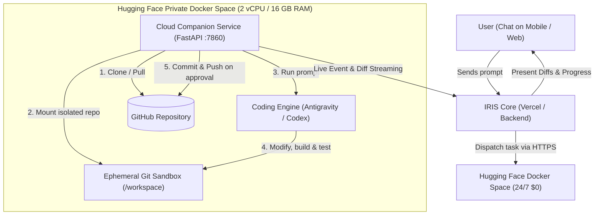

# Architecture Plan: Hugging Face 24/7 Cloud Execution Sandbox for IRIS ($0 / No Credit Card)

## Executive Summary

This plan outlines the architecture, code changes, and step-by-step setup to establish a **24/7 cloud execution sandbox** using **Hugging Face Spaces (Docker runtime)** at **$0 cost** with **no credit card required**.

This sandbox allows your IRIS Coding Coworker to:
1. Run coding tasks in the cloud even when your local PC is **turned off or asleep**.
2. Keep your personal computer's filesystem completely separate and untouched.
3. Pull code directly from a target GitHub repository, execute changes via coding engines (Antigravity CLI, Codex CLI, or autonomous agent runners), test/build, and push verified commits directly back to GitHub.

---

## 1. System Requirements & Hugging Face Specifications

| Feature | Hugging Face Free Tier Specification |
| :--- | :--- |
| **Cost** | **$0.00 Forever** |
| **Credit Card** | **None Required** |
| **Compute** | 2 vCPU, 16 GB RAM, 50 GB disk |
| **Runtime** | Custom Docker container |
| **Privacy** | **Private Space** (Accessible only with Bearer API token) |
| **Port** | `7860` (Default HTTP/WebSocket port for Spaces) |
| **Lifespan** | Stays alive 24/7 (wakes automatically on incoming requests) |

---

## 2. Component Design

### Component A: The Cloud Companion (`iris-cloud-companion`)
A lightweight, containerized execution companion hosted on Hugging Face that mirrors the interface of the local Windows execution companion.

#### Files in the Hugging Face Space:
1. **`Dockerfile`**:
   - Base image: `python:3.11-slim-bookworm` + `nodejs 20` + `git` + `build-essential`.
   - Pre-installs `antigravity-cli` and `codex-cli`.
   - Exposes port `7860`.
2. **`main.py`**:
   - FastAPI application protected by `IRIS_COMPANION_SECRET`.
   - `POST /api/execute`: Clones the repo branch, writes instructions, and spawns the coding engine.
   - `GET /api/stream/{task_id}`: Real-time Server-Sent Events (SSE) or WebSocket log streaming.
   - `POST /api/stop/{task_id}`: Kills child processes and cancels running tasks instantly.
   - `GET /api/diff/{task_id}`: Runs `git diff` and returns changed files and statistics.
   - `POST /api/push/{task_id}`: Commits approved changes and pushes them to GitHub.
3. **`requirements.txt`**:
   - `fastapi`, `uvicorn`, `pydantic`, `httpx`.

---

### Component B: Hugging Face Secrets Configuration

To run headlessly and securely without hardcoding credentials in code:

| Secret Name | Purpose | Source |
| :--- | :--- | :--- |
| `IRIS_COMPANION_SECRET` | Shared bearer token for IRIS to authenticate to the Space | Random 32-char hex string |
| `GITHUB_PAT` | Fine-grained Personal Access Token to clone and push code | GitHub Settings ➔ Developer Settings |
| `GEMINI_OAUTH_TOKEN` / `GEMINI_API_KEY` | Headless authentication for Antigravity engine | Exported from local `~/.gemini/` |
| `OPENAI_API_KEY` / `CODEX_API_KEY` | Authentication for Codex CLI | OpenAI / Codex dashboard |

---

### Component C: IRIS Core Integration Changes

1. **Backend Companion Router (`backend/app/coding/remote_companion.py`)**:
   - Implement `RemoteCloudCompanion` client implementing the same execution interface as [`WindowsExecutionCompanion`](file:///C:/kirtan/IRIS/backend/app/coding/windows_companion.py).
   - In [`execution.py`](file:///C:/kirtan/IRIS/backend/app/coworkers/execution.py), dispatch tasks to either:
     - `local`: Local Windows companion (ConPTY).
     - `cloud`: Hugging Face Space companion.
2. **Settings & Project Registry Update**:
   - Add `cloud_companion_url` (e.g. `https://<hf-user>-iris-sandbox.hf.space`) and `cloud_companion_token` to system configuration.
   - Add `git_remote_url` (e.g. `https://github.com/user/my-repo.git`) to `CodingProject` schema so the cloud runner knows where to clone.
3. **Frontend UI Toggle**:
   - In [`CoworkerChatView.tsx`](file:///C:/kirtan/IRIS/frontend/src/features/coworkers/CoworkerChatView.tsx), add an execution target selector badge:
     - `💻 Local PC` (runs on Windows companion)
     - `☁️ Hugging Face Cloud` (runs on 24/7 cloud sandbox, PC can be shut down)

---

## 3. Step-by-Step Implementation Roadmap

### Step 1: Create the Hugging Face Docker Space
1. Log in to [Hugging Face](https://huggingface.co).
2. Click **New Space**.
3. Settings:
   - **Space Name:** `iris-sandbox`
   - **License:** `mit`
   - **Space SDK:** `Docker` ➔ `Blank`
   - **Space Hardware:** `CPU Basic · 2 vCPU · 16 GB RAM · Free`
   - **Visibility:** `Private`
4. Go to **Settings** ➔ **Variables and secrets**:
   - Add Secret: `IRIS_COMPANION_SECRET`
   - Add Secret: `GITHUB_PAT`

### Step 2: Push Companion Files to Hugging Face
Push the `Dockerfile`, `main.py`, and `requirements.txt` to the Space repository (via Git or the Hugging Face Web Editor). The Space will automatically build the container and start running on port `7860`.

### Step 3: Implement Remote Companion Adapter in IRIS
1. Add [`backend/app/coding/remote_companion.py`](file:///C:/kirtan/IRIS/backend/app/coding/remote_companion.py) to send task requests to the Hugging Face Space.
2. Update [`execution.py`](file:///C:/kirtan/IRIS/backend/app/coworkers/execution.py) to stream logs from the remote companion.
3. Update settings schema to persist Hugging Face credentials.

### Step 4: Verification & Testing
1. Trigger a test task from IRIS with target `☁️ Hugging Face Cloud`.
2. Confirm the remote space clones the GitHub repository, runs the engine, and streams events.
3. Put local PC to sleep or disconnect network; verify that execution continues in the Space.
4. Review diff in IRIS chat and click "Approve & Push"; verify the commit lands on the GitHub remote repository.

---

## 4. Key Questions & Design Decisions for You

Before implementing the code:
1. **GitHub Repository Target:** Do you already have a GitHub repository (public or private) you want to use for the first test?
2. **Default Engine Preference:** When running in the cloud, do you prefer **Codex CLI** (API key based, simplest in headless Docker) or **Antigravity CLI** (requires mounting Google credentials)?
3. **Execution Choice:** Would you like IRIS to support **switching** between Local Windows Companion and Hugging Face Cloud, or make Hugging Face the primary execution target?
